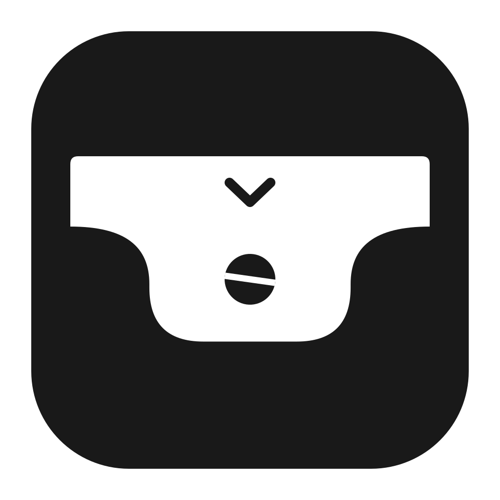
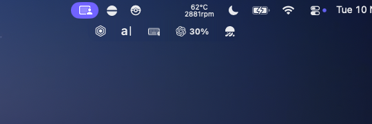

# Menu Bar Bar



A menu bar inside your menu bar. Tuck less-used Mac utilities behind a chevron and open them from a small shelf that blends into the bar above it.



**Early preview.** Built and tested on Apple Silicon with macOS 26. The app targets macOS 14 through 26; macOS 27 is not supported. Native drag transfers are still experimental and may briefly hide or pause the pointer. See [known limitations](#known-limitations) before installing.

## Install and run

If you use Claude Code, run:

```sh
claude 'install and run https://github.com/alfonsokkim/menu-bar-bar following its readme'
```

Or install manually. You need the Xcode Command Line Tools and Swift 6.2 or newer (`swift --version`). If the installed tools have an older Swift version, install a newer Xcode release and select its toolchain. No Apple developer account or personal signing certificate is required.

```sh
git clone https://github.com/alfonsokkim/menu-bar-bar.git
cd menu-bar-bar
./build.sh
mkdir -p "$HOME/Applications"
ditto "dist/Menu Bar Bar.app" "$HOME/Applications/Menu Bar Bar.app"
open "$HOME/Applications/Menu Bar Bar.app"
```

If Menu Bar Bar is already installed, quit it and update that same app bundle rather than keeping multiple copies. The build script signs locally with an ad-hoc signature. Source builds are not notarized by Apple. An optional `MENUBARBAR_SIGN_IDENTITY` environment variable lets you sign with your own certificate. Rebuilding with a different signature can require granting permissions again.

### First launch

1. Enable **Screen Recording** and **Accessibility** from Menu Bar Bar's setup window. macOS may require you to quit and reopen the app after changing Screen Recording access. Grant these permissions directly in System Settings.
2. Click **Arrange**, then hold Command and drag the icons you want to bundle to the left of the divider. Keep your everyday icons on the right.
3. Click **Open bundle** or the chevron to collapse those originals into the shelf.

Open at login is optional. Right-click the chevron for Settings, arrangement mode, and Quit. Quitting restores the hidden icons.

## Using the bundle

- Click the chevron to open it. Click outside or press Escape to close it.
- Click a bundled icon to open its menu. Standard accessible menus appear below the shelf. Custom popovers depend on the original app's accessibility support.
- Hold Command and drop a native menu bar icon onto the chevron to add it.
- Command-drag inside the shelf to reorder its icons.
- Command-drag out onto the menu bar to return an icon. Empty space left of the chevron targets its left side; gaps among icons on the right target that gap.
- Use **Add an icon…** in Settings or **Move to Menu Bar** in an icon's context menu as alternatives to dragging.

The shelf follows the actual menu bar height and each icon's native spacing. Its flared edges join the bar, and its background samples the material macOS is rendering rather than guessing a wallpaper colour. The chevron drops into the opening and returns when it closes. Reduce Motion uses a short fade instead.

## Privacy and permissions

Screen Recording supplies the real icon previews and the menu bar background. Images are processed in memory on your Mac, refreshed while the shelf is open, and are not saved or uploaded by the app. macOS may display its screen-capture indicator while this is active.

Accessibility lets Menu Bar Bar invoke the original menus and move native status items. While running, the app monitors mouse events to recognise Command-drags and clicks outside the shelf. Additional mouse event taps are active briefly during native transfers. It does not record typed text. Local macOS diagnostic logs include cursor positions and transfer state for troubleshooting. There are no accounts, analytics, or network services in the app.

## Known limitations

- This is an early preview, not a polished release. Some drag transfers can fail to land in the requested position. Use Arrange if that happens.
- Brief cursor hiding is part of native relocation. Intermittent sticky or invisible-pointer reports are still under investigation; the current build has not established a complete fix.
- The latest left/right drop placement passes geometry tests but still needs broader physical testing.
- Only macOS 26 on Apple Silicon has been tested live. Other supported macOS versions and Intel Macs are unverified.
- macOS 27 changes menu bar internals and is not supported by this backend.
- Very crowded bars, the notch, fullscreen, auto-hidden menu bars, system-only items, and apps without accessible menus can limit functionality.
- Custom popovers are repositioned only when the original app exposes an identifiable, movable accessibility window. Others retain their normal placement. Distinct secondary-click actions are not supported.
- The app uses private macOS window and cursor APIs. Future macOS updates may break these behaviours.

## Development

```sh
swift test
./build.sh
```

`Sources/Tray` contains the AppKit app. `Sources/TrayCore` contains geometry, ordering, and event-accounting logic with unit tests in `Tests/TrayCoreTests`.

For a separately signed, notarized download, build first, then use your own Developer ID Application certificate and a configured `notarytool` Keychain profile:

```sh
export MENUBARBAR_SIGN_IDENTITY='Developer ID Application: Your Name (TEAMID)'
export MENUBARBAR_NOTARY_PROFILE='your-notarytool-keychain-profile'
./scripts/package-release.sh
```

The packaging script verifies signing and Apple's notarization result before producing a ZIP. It keeps signing credentials outside the repository. No notarized binary is included in this source preview.
